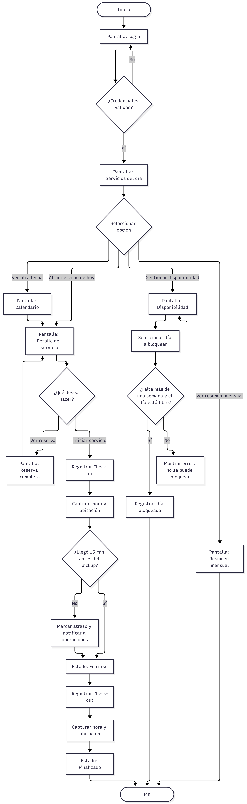
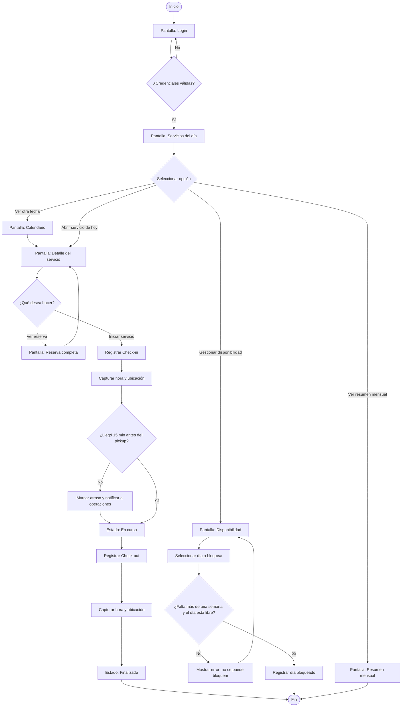

# Proyecto Lince — SouthTour

**Propósito:** Aplicación móvil Android para los guías y transportistas de Southbound. Permite consultar los servicios que el equipo de operaciones ya les asignó, revisar su detalle y los requisitos de cada agencia, gestionar su disponibilidad y registrar check-in y check-out en terreno con hora y ubicación.

La aplicación **no asigna servicios**: la asignación la sigue resolviendo el equipo de operaciones y la app solo la consume. El pasajero no tiene acceso a esta aplicación.

> MVP académico de DSY1105 - Aplicaciones Móviles (Duoc UC), Evaluación Parcial 4/5. Consume la **Lince API** académica de Southbound (solo lectura, datos sintéticos) y guarda los registros nuevos en un **backend propio Spring Boot**. No se conecta a sistemas productivos.

## 🎨 Identidad Visual

- **Logotipo:** `docs/diseno/Logo_SouthTour.png`
- **Paleta de colores** (extraída del logotipo corporativo de Southbound):

| Rol | HEX | Uso |
|---|---|---|
| Principal | `#5E4125` | TopAppBar, NavigationBar, botones primarios |
| Secundario | `#3297A0` | Acentos, hora de pickup destacada, estados seleccionados |
| Fondo | `#F7F3EE` | Fondo de pantallas, con tarjetas en blanco |
| Texto | `#3A2E22` | Textos principales (secundario `#6B5B4B`) |
| Confirmado | `#6B7445` | Estado confirmado y check-in dentro del horario |
| Alerta | `#C0623F` | Cancelado, atraso y errores de validación |

## 🔄 Flujo de Usuario (UML)





## 📱 Pantallas Principales

Las propuestas visuales iniciales se encuentran en `docs/diseno/` (archivos `01-login.png` a `08-resumen-mensual.png`).
Las pantallas finales diseñadas en **Google Stitch**, que son las que implementa la app, están en `docs/diseno/stitch/`, junto con el sistema de diseño "Atacama Fieldwork" (`DESIGN.md`).

| # | Pantalla | Objetivo |
|---|---|---|
| 1 | Login | Autenticar al usuario y cargar su rol |
| 2 | Servicios del día | Mostrar lo asignado para hoy con hora y punto de pickup |
| 3 | Calendario de servicios | Consultar otras fechas (asignación hasta 3 meses adelante) |
| 4 | Detalle del servicio | Excursión, drop off, contraparte y requisitos de la agencia |
| 5 | Reserva completa | Itinerario completo de los pasajeros por número de reserva |
| 6 | Check-in / Check-out | Registro de inicio y término con hora y ubicación |
| 7 | Disponibilidad | Bloqueo de días con validación de una semana de anticipación |
| 8 | Resumen mensual | Servicios realizados, cancelados y monto acumulado |

## 🧩 Problemática del cliente (Southbound)

- **Coordinación manual:** los servicios confirmados salen del ERP a una planilla y coordinación asigna guías y transportistas uno a uno.
- **¿Llegó a tiempo?** No había evidencia de que el guía o transportista llegara al hotel **15 minutos antes del pickup** y **dentro de la zona correcta**.
- **Disponibilidad:** no existía un canal para bloquear días ni confirmar o rechazar servicios con trazabilidad.

**Solución:** Lince permite a guías y transportistas ver sus servicios reales (Lince API), confirmar su llegada con **geocerca de 150 m** y a coordinación saber en tiempo real qué pasa.

## 🏗️ Arquitectura

```
App Android (Kotlin + Compose + Material 3, ES/EN)
  Pantalla (Compose) → ViewModel (StateFlow) → RepositorioLince
                                                 ├── Retrofit → Lince API de Southbound (SOLO LECTURA, X-API-Key)
                                                 ├── Retrofit → Backend propio Spring Boot (escritura, JWT)
                                                 └── Room (caché + cola offline) · DataStore (sesión e idioma)
                                                       └── WorkManager sincroniza la cola al volver internet

Backend propio (backend/): Spring Boot + JPA + H2 (archivo) + JWT + Swagger
  Controlador → Servicio (reglas: geocerca Haversine, 15 min, 7 días) → Repositorio JPA → BD
  El backend vuelve a consultar la Lince API para verificar que el servicio está asignado al usuario.
```

**Separación de responsabilidades:** la Lince API del cliente es de **solo lectura** (servicios, reservas, guías, transportistas, catálogos, resumen). Todo lo nuevo —check-in/out, geocercas, incidencias, disponibilidad y confirmaciones— se guarda en el **backend propio**.

## 📂 Estructura del repositorio

```
ProyectoLince-Equipo10/
├── README.md
├── SouthTour/                          → App Android (abrir esta carpeta en Android Studio)
│   └── app/src/
│       ├── main/java/com/equipo10/lince/
│       │   ├── model/                  → Modelos y estados de pantalla (UiState)
│       │   ├── data/RepositorioLince.kt→ Único acceso a datos (Lince API + backend + Room)
│       │   ├── data/remoto/            → Retrofit: LinceApi, BackendApi, Red (interceptores, errores requestId)
│       │   ├── data/local/             → Room: Entities, DAOs y LinceDatabase (caché y cola offline)
│       │   ├── data/Sesion.kt          → DataStore: JWT, usuario e idioma
│       │   ├── sync/                   → WorkManager: SincronizarHitosWorker
│       │   ├── viewmodel/              → ViewModel + StateFlow por pantalla
│       │   ├── ui/                     → Pantallas, navegación por rol, componentes y tema
│       │   └── util/Geocerca.kt        → Haversine y regla de llegada
│       ├── main/res/values(-en)/       → Textos en español e inglés
│       ├── test/                       → JUnit + MockK (ViewModel, Repositorio, Geocerca)
│       └── androidTest/                → Compose UI Test (formulario de login)
├── backend/                            → Microservicio Spring Boot (Swagger, JWT, BD)
│   ├── src/main/java/cl/duoc/lince/    → modelo, repositorio, servicio, seguridad, web, lince
│   └── config/secretos.properties.example
└── docs/                               → Diseño (UML, Stitch) y evidencias
```

## 🖥️ Backend propio (Spring Boot)

| | |
|---|---|
| Tecnologías | Spring Boot 4.1 · Spring Data JPA · H2 en archivo (`backend/data/`) · Spring Security + JWT · springdoc OpenAPI |
| Swagger UI | **http://localhost:8080/swagger-ui.html** (botón *Authorize* → pegar el token del login) |
| OpenAPI JSON | http://localhost:8080/v3/api-docs |
| Entidades | `Usuario`, `Geocerca`, `Hito` (check-in/out/posición), `Incidencia`, `Bloqueo`, `Confirmacion` |

| Método | Endpoint | Rol | Descripción |
|---|---|---|---|
| POST | `/api/auth/login` | público | Login con RUT o correo → JWT + rol |
| GET | `/api/reglas` | público | Radio, precisión GPS, minutos antes y días de anticipación vigentes |
| POST | `/api/hitos` | guía / transportista | Check-in, check-out o posición. **El servidor vuelve a validar** asignación (Lince API), estado (XX/CX/DL), fecha, geocerca, precisión y 15 min. Idempotente por `idempotencia` |
| GET | `/api/hitos/mios` · `/api/hitos/servicio/{id}` | autenticado | Mis hitos |
| GET/POST/PUT/DELETE | `/api/incidencias` | autenticado | CRUD de incidencias (las automáticas las crea el servidor al rechazar un check-in) |
| GET/POST/PUT/DELETE | `/api/geocercas` | lectura: todos · escritura: COORDINADOR | Hoteles con coordenada central y radio |
| GET/POST/DELETE | `/api/disponibilidad` | autenticado | Bloqueo de días (≥ 7 días de anticipación y sin servicio asignado) |
| GET/PUT | `/api/confirmaciones/{servicioId}` | autenticado | Confirmar o rechazar una asignación |
| GET | `/api/coordinacion/hitos` · `/posiciones` · `/usuarios` | COORDINADOR | Panel operativo y última posición (sin rastreo 24/7) |

Errores en formato `{ "error": { "code", "message", "requestId" } }` (igual que la Lince API).

## 🌐 API externa: Lince API de Southbound (solo lectura)

- Base: `https://ws.southbound.travel/lince-api` · Swagger: `https://ws.southbound.travel/lince-api/api-docs/`
- Header **`X-API-Key`**: se carga desde `local.properties` (excluido de Git) → `BuildConfig`. **Nunca se sube al repositorio.**
- Endpoints usados: `/api/v1/servicios` (filtros `fechaDesde`, `fechaHasta`, `tipo`, `guiaId`, `transportistaId`, paginación `page`/`pageSize` ≤ 100), `/servicios/{id}`, `/guias`, `/transportistas`, `/catalogos`, `/resumen`.
- Estados: servicio **CF / RQ / WL / XX** y asignación (StatusPL) **CF / RQ / DL / CX / null**. Errores 400/401 se muestran con su `requestId`.

## ▶️ Cómo ejecutar

### 1. Backend
1. Copiar `backend/config/secretos.properties.example` como `backend/config/secretos.properties` y completar la X-API-Key y un secreto JWT.
2. Desde la carpeta `backend/` (Windows, con `JAVA_HOME` apuntando al JDK 25 de Android Studio, carpeta `jbr`):
   ```
   gradlew.bat bootJar
   java -jar build\libs\lince-backend-1.0.0.jar
   ```
3. Abrir http://localhost:8080/swagger-ui.html. La primera vez se crean los usuarios de prueba y las 14 geocercas.

### 2. App Android
1. En `SouthTour/local.properties` (no se sube a Git) agregar:
   ```
   lince.backend.url=http://10.0.2.2:8080/          # emulador; en teléfono físico: http://IP_DEL_PC:8080/
   lince.api.key=LA_X_API_KEY_DEL_CURSO
   ```
2. Abrir `SouthTour/` en Android Studio, sincronizar y presionar **Run ▶**.

### 3. APK release firmada
1. Crear el keystore **fuera del repositorio**: `keytool -genkeypair -keystore southtour-release.jks -alias southtour -keyalg RSA -keysize 2048 -validity 10000`
2. Agregar en `SouthTour/local.properties`: `firma.keystore`, `firma.storePassword`, `firma.keyAlias`, `firma.keyPassword`.
3. `gradlew.bat :app:assembleRelease` → `SouthTour/app/build/outputs/apk/release/app-release.apk` (versión **2.0.0**, versionCode **2**). El `signingConfigs` de `app/build.gradle.kts` lee esos valores; el `.jks` y las claves nunca se suben.
4. Instalar en el teléfono: `adb install app-release.apk` (o copiar el archivo y abrirlo).

### Usuarios de prueba (clave `1234`, datos ficticios)

| Rol | RUT | Correo | Recurso en Lince API |
|---|---|---|---|
| Guía | 15.482.910-K | guia@southbound.cl | guía 37 |
| Transportista | 12.345.678-5 | transportista@southbound.cl | transportista 2 |
| Coordinación | 11.111.111-1 | coordinacion@southbound.cl | — |

## 🧪 Pruebas y cobertura

| Tipo | Dónde | Cómo ejecutar |
|---|---|---|
| Unitarias JUnit + MockK (**107 pruebas**) | `SouthTour/app/src/test/` | `gradlew.bat :app:testDebugUnitTest` |
| Cobertura Kover (ViewModel + Repositorio + Geocerca): **99,4 % de líneas** (mínimo exigido 90 %) | reporte en `app/build/reports/kover/htmlDebug/index.html` | `gradlew.bat :app:koverHtmlReportDebug :app:koverVerifyDebug` |
| Compose UI Test (formulario de login con datos inválidos, **3 pruebas**) | `SouthTour/app/src/androidTest/` | `gradlew.bat :app:connectedDebugAndroidTest` (emulador o teléfono conectado) |

Casos cubiertos: geocerca dentro/fuera del radio, regla de 15 minutos, GPS impreciso, roles, estados de servicio (CF/XX, CX/DL), errores de Retrofit (400/401/404 con requestId), sin conexión → cola en Room → sincronización sin duplicados.

## 👥 Integrantes (Equipo 10)

| Integrante | Rol |
|---|---|
| Nicolás López | Diseñador UX/UI |
| Ignacio Oyarzun | Arquitecto de Software |
| Pablo Velásquez | Desarrollador Mobile |

Sección DSY1105-003D

## 🛠️ Tecnologías

- Kotlin · Jetpack Compose (Material 3) · MVVM · Navigation Compose
- Retrofit + OkHttp + Gson (Lince API y backend propio)
- Room + KSP · DataStore · WorkManager (offline y sincronización)
- LocationManager (GPS, geocerca con Haversine) · Activity Result API (cámara)
- JUnit + MockK + kotlinx-coroutines-test · Kover · Compose UI Test
- Spring Boot 4 · Spring Data JPA · H2 · Spring Security + JWT (jjwt) · springdoc OpenAPI (Swagger)
