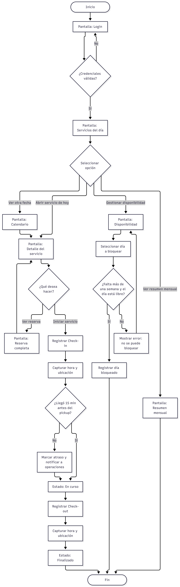
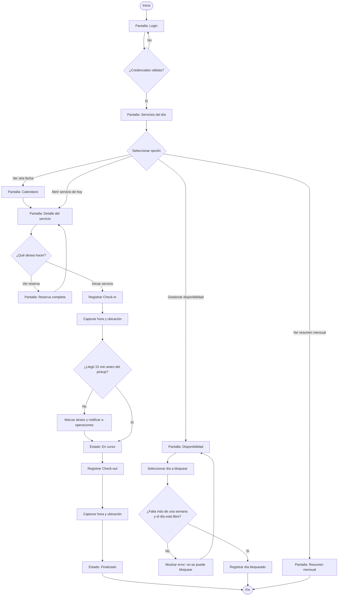

# Proyecto Lince — SouthTour

**Propósito:** Aplicación móvil Android para los guías y transportistas de Southbound. Permite consultar los servicios que el equipo de operaciones ya les asignó, revisar su detalle y los requisitos de cada agencia, gestionar su disponibilidad y registrar check-in y check-out en terreno con hora y ubicación.

La aplicación **no asigna servicios**: la asignación la sigue resolviendo el equipo de operaciones y la app solo la consume. El pasajero no tiene acceso a esta aplicación.

> MVP académico de la asignatura DSY1105 - Aplicaciones Móviles (Duoc UC). Trabaja con datos ficticios y una API REST simulada; lo que registra el usuario (check-in/out, bloqueos e incidencias) se guarda en el teléfono con Room. No se conecta a sistemas productivos de Southbound.

## 🎨 Identidad Visual

- **Logotipo:** `docs/diseno/Logo_SouthTour.png`
- **Paleta de colores** (extraída del logotipo corporativo de Southbound):

| Rol | HEX | Uso |
|---|---|---|
| Principal | `#5E4125` | TopAppBar, NavigationBar, botones primarios |
| Secundario | `#3297A0` | Acentos, hora de pickup destacada, estados seleccionados |
| Fondo | `#F7F3EE` | Fondo de pantallas, con tarjetas en blanco |
| Texto | `#3A2E22` | Textos principales (secundario `#6B5B4B`) |
| Confirmado | `#6B7445` | Estado confirmado y check-in dentro del horario |
| Alerta | `#C0623F` | Cancelado, atraso y errores de validación |

## 🔄 Flujo de Usuario (UML)





## 📱 Pantallas Principales

Las propuestas visuales iniciales se encuentran en `docs/diseno/` (archivos `01-login.png` a `08-resumen-mensual.png`).
Las pantallas finales diseñadas en **Google Stitch**, que son las que implementa la app, están en `docs/diseno/stitch/`, junto con el sistema de diseño "Atacama Fieldwork" (`DESIGN.md`).

| # | Pantalla | Objetivo |
|---|---|---|
| 1 | Login | Autenticar al usuario y cargar su rol |
| 2 | Servicios del día | Mostrar lo asignado para hoy con hora y punto de pickup |
| 3 | Calendario de servicios | Consultar otras fechas (asignación hasta 3 meses adelante) |
| 4 | Detalle del servicio | Excursión, drop off, contraparte y requisitos de la agencia |
| 5 | Reserva completa | Itinerario completo de los pasajeros por número de reserva |
| 6 | Check-in / Check-out | Registro de inicio y término con hora y ubicación |
| 7 | Disponibilidad | Bloqueo de días con validación de una semana de anticipación |
| 8 | Resumen mensual | Servicios realizados, cancelados y monto acumulado |

## 📂 Estructura del repositorio

```
ProyectoLince-Equipo10/
├── README.md
├── SouthTour/                  → Proyecto Android Studio (abrir esta carpeta)
│   ├── app/src/main/java/com/equipo10/lince/
│   │   ├── model/              → Entidades y estados de pantalla (UiState)
│   │   ├── data/               → Repositorio (datos ficticios + Room) y GPS del dispositivo
│   │   │   └── local/          → Room: Entities, DAOs y LinceDatabase
│   │   ├── viewmodel/          → ViewModel + StateFlow por pantalla
│   │   ├── ui/                 → Pantallas, navegación, componentes y tema
│   │   └── util/               → Fechas, horas y montos
│   └── docs/avance/            → Guía de presentación del avance
└── docs/
    ├── diseno/
    │   ├── Logo_SouthTour.png
    │   ├── Flujo_UML.png
    │   ├── 01-login.png … 08-resumen-mensual.png   → propuestas iniciales
    │   └── stitch/             → pantallas de Google Stitch + DESIGN.md
    └── evidencias/
        ├── Evidencia_Clase_01_MVP_Equipo10.docx
        └── Evidencia_Clase_02_Diseno_Equipo10.docx
```


## 📲 Aplicación (avance de desarrollo)

La app está en la carpeta **`SouthTour/`** (abrir esa carpeta en Android Studio). Implementa la interfaz diseñada en Google Stitch (sistema "Atacama Fieldwork") con **Kotlin, Jetpack Compose, Material 3, MVVM, ViewModel + StateFlow, Navigation Compose y Room**.

| Pantalla | Estado |
|---|---|
| Login (RUT o correo) | ✅ validación por campo (obligatorios y formato de RUT / correo) |
| Hoy · Servicios del día | ✅ |
| Calendario | ✅ búsqueda por texto + filtros por estado (vista mensual en la próxima entrega) |
| Detalle del servicio y Reserva completa | ✅ |
| Check-in / Check-out | ✅ hora, control de atraso y **ubicación GPS**, guardados con Room |
| Reportar incidencia | ✅ formulario validado + **foto con la cámara**, guardado con Room |
| Disponibilidad | ✅ regla de una semana, bloqueos guardados con Room · 🔜 vista mensual |
| Resumen mensual | ✅ incluye cancelados pagados y puntualidad |
| Perfil (desde el avatar) | ✅ |

**Usuarios de prueba** (clave `1234`): guía `15.482.910-K` · transportista `12.345.678-5`

### ✅ Requisitos de la Evaluación Parcial 2 y dónde se cumplen

| Requisito | Dónde |
|---|---|
| MVVM (Model, View, ViewModel, Repository) | `model/`, `ui/screens/`, `viewmodel/`, `data/RepositorioLince.kt` |
| Material 3 y navegación | `ui/theme/`, `ui/navigation/AppNavigation.kt` (rutas con argumentos) |
| ViewModel + StateFlow | `viewmodel/*ViewModel.kt` + `model/*UiState.kt` |
| Formularios validados | `IncidenciaScreen` / `IncidenciaViewModel` (tipo, descripción ≥ 10 caracteres, pasajeros entre 0 y los de la reserva, confirmación) · `LoginScreen` / `LoginViewModel` |
| Listas, búsqueda, filtros y detalle | Calendario (`ServiciosViewModel.cambiarBusqueda()` y `cambiarFiltro()`) → Detalle → Reserva |
| Persistencia local con Room | `data/local/`: tablas `registros_servicio`, `bloqueos` e `incidencias` (se conservan al cerrar la app) |
| Recurso nativo 1: **GPS** | `data/UbicacionDispositivo.kt` + permiso `ACCESS_FINE/COARSE_LOCATION` pedido en `DetalleServicioScreen` |
| Recurso nativo 2: **Cámara** | `IncidenciaScreen` con `ActivityResultContracts.TakePicturePreview` (foto guardada en la memoria interna) |

## ▶️ Cómo ejecutar

1. Clonar el repositorio y abrir la carpeta **`SouthTour/`** en Android Studio (versión con AGP 9.2 o superior).
2. Esperar la sincronización de Gradle (usa el JDK que trae Android Studio).
3. Crear o elegir un emulador con **API 37** (por ejemplo, Pixel o Medium Phone) y presionar **Run ▶**.
4. Ingresar con un usuario de prueba. Para probar el GPS en el emulador: *Extended controls (⋯) → Location* y fijar un punto.

Desde la terminal (Windows), con `JAVA_HOME` apuntando al JDK de Android Studio (carpeta `jbr`):

```
gradlew.bat :app:installDebug
```

## 👥 Integrantes (Equipo 10)

| Integrante | Rol |
|---|---|
| Nicolás López | Diseñador UX/UI |
| Ignacio Oyarzun | Arquitecto de Software |
| Pablo Velásquez | Desarrollador Mobile |

Sección DSY1105-003D

## 🛠️ Tecnologías

- Kotlin
- Jetpack Compose (Material Design 3)
- Arquitectura MVVM
- Room + KSP (persistencia local en SQLite)
- LocationManager (GPS) y Activity Result API (cámara)
- Retrofit (planificado para conectar con la API real en la EFT)
